# 数据模型、API 与生命周期契约

## 持久化与来源

| 实体 | 保存内容与约束 |
| --- | --- |
| ScanRun | 原始 report.json 字节及 SHA-256、run_id 主键、源码 revision/fingerprint、时间、执行状态、工具步骤/版本；不可更新删除 |
| Finding | 人工管理容器，状态、风险、版本、创建/更新时间及关联归档目标；初始为待研判，不能解释成独立漏洞 |
| FindingKey | 工具/规则/位置/逻辑目标组成的 fingerprint 身份及管理容器映射；同工具跨运行追踪，人工关联只修改该映射 |
| Observation | 唯一 (run_id, fingerprint)，原始工具观察 JSON、规则、位置、严重度、置信度、时间和证据关系；存源码对应 Git revision 的脱敏代码片段；不可修改 |
| Evidence | 运行/路径唯一、manifest SHA-256、原始字节快照或明确 missing；不可修改。原文件缺失时不伪造内容 |
| FindingHistory | 导入、状态、备注、修复、复测和关联的时间/actor/依据及前后状态，追加审计、不可修改删除 |
| Repair | 修复声明的 reference、说明与登记时间；不可修改；声明不等于修复验证 |
| Verification | 修复声明、实际已导入 ScanRun、可用 Evidence IDs、覆盖范围、结论、备注、登记时间；不可修改 |

SQLite 外键、唯一约束、单事务导入与写事务、原始表 UPDATE/DELETE 拒绝触发器保障一致性。状态版本防止过期页面并发覆盖；人工关联也检查版本并同时记录两侧审计。schema user_version=1，未来 Phase 6 可以调用现有 Gate 和 API，不直接写数据库。

严格验证 Phase 4 JSON Schema（含 date-time）、复用快照内现有的 validate_report，并额外核对运行来源、fingerprint 重算、唯一性、各工具数量/状态一致性和证据引用集合。run_id 相同、原报告摘要相同则幂等；摘要改变拒绝。证据存在但 hash 不匹配拒绝整笔导入；证据缺失允许导入且明确展示 missing。报告 8 MiB、单份证据 8 MiB、总证据 48 MiB、观察项 10000、manifest 2000 条上限。

仅同工具/规则/位置/逻辑目标指纹自动关联。同位置不同规则也不自动合并；跨工具有重叠风险，须人工说明依据后关联。原管理项归档可查看历史，原观察项不动，后续相同指纹进入目标项。为了避免混淆已处置历史，只允许待研判来源项（无修复/复测）关联至待研判或已确认目标。关联后管理风险取最高报告风险。改行号、改规则或重命名源码可能产生新指纹，应人工研判关联。

报告观察项数量、当前管理项数量和独立漏洞数量分开。independent_vulnerability_count 始终 null，UI 显示“待确认”；确认状态表示用户确认该管理项，不意味着已证实它与所有其他管理项独立。原报告 Semgrep 2、CodeQL 3、ZAP 0 的五个报告点不能直接称五个独立漏洞。ZAP 成功且 0 告警与失败数量 null 分别展示。

## API v1

路径以 /api 开头。机器契约由 /openapi.json 提供；服务不从公网加载 Swagger 脚本。

| 方法与路径 | 行为 |
| --- | --- |
| GET /health、/session | DB 健康与本机写令牌；重启令牌变化，客户端收到 403 后重新取得 |
| GET /summary、/lifecycle | 真实聚合、风险分布、近期运行、允许转换 |
| POST /imports | {run_id} 从配置允许目录只读导入；返回 imported 与缺失证据 warnings |
| GET /runs | page/page_size 分页列表；包含真实工具执行状态、模式、数量 |
| GET /runs/{run_id} | 运行、原报告摘要、源码版本、工具版本、证据元数据和关联管理项 |
| GET /findings | tool/severity/status/query 筛选；created_at/updated_at/severity 排序；order=asc/desc；page/page_size |
| GET /findings/{id} | 描述、状态、版本、源码片段、全部跨运行观察项与证据、历史、修复、复测、关联来源 |
| POST /findings/{id}/status | {status, version, note, verification_id?} 合法转换和关闭依据校验 |
| POST /findings/{id}/notes | {note} 追加人工备注 |
| POST /findings/{id}/repairs | {reference, note} 修复中登记声明 |
| POST /findings/{id}/verifications | {run_id, repair_id, evidence_ids, conclusion, scope, note} 登记复测结论 |
| POST /findings/{id}/associations | {target_id, version, note} 保守的人工同源确认 |
| GET /evidence/{id} | 允许报告的脱敏文本预览，带 SHA-256、redacted、truncated；无任意路径 API |

所有写入必须使用 application/json 和 X-Dashboard-Token。输入 extra 禁止，多行说明有长度限制，page_size 1–100，错误状态/工具/排序/页码返回 422。列表 {items,total,page,page_size}；状态修改返回最新详情。错误统一 {error:{code,message,request_id}}；不回显敏感输入，404 无对象、409 冲突或非法操作、403 边界拒绝、413 大小限制、415 非 JSON、422 参数/结构无效、503 数据库异常、500 内部异常。

## 生命周期

每次转换都要求 3–4000 字符的依据，并追加 actor=local-user、时间、前后状态与记录版本。固定本地 actor 是单用户审计标签，不能冒充可验证身份。

| 当前状态 | 允许转换 | 附加条件 |
| --- | --- | --- |
| unreviewed 待研判 | confirmed、false_positive、accepted_risk | 研判/误报/风险接受依据 |
| confirmed 已确认 | fixing、false_positive、accepted_risk | 操作依据 |
| fixing 修复中 | confirmed、pending_verification、accepted_risk | 待复测前必须有修复声明 |
| pending_verification 待复测 | fixing、closed、accepted_risk | 关闭须本轮最新有证据的 remediated 结论 |
| closed 已关闭 | confirmed | 重开依据；旧复测不能用于新一轮关闭 |
| false_positive 误报 | unreviewed | 重新研判依据 |
| accepted_risk 接受风险 | confirmed | 重新处理依据 |

Verification 三种结论：inconclusive 未定、still_present 仍存在、remediated 人工确认已修复。全部要求 repair_id 属于该管理项、evidence_ids 实际存在且属于所选运行、非空 scope/note。remediated 额外要求扫描 COMPLETED 且报告时间晚于修复声明、该运行不再报告本管理项。即使满足这些条件也仅保存人工结论，不自动变状态。单次“没检出”不是充分证明，使用者必须在 scope/note 说明覆盖根因和复现输入的证据。平台不能自动证明语义上已经消除漏洞。

closed 需要显式 verification_id，属于本项、本轮进入待复测后登记、最新复测且为 remediated、所关联运行 COMPLETED。后续失败/未定复测会阻止引用更早成功记录关闭。重开后不能重新使用旧轮结论。

## 安全查看与限制

导入 run_id 禁止路径分隔符、编码路径与任意绝对路径；每份 manifest 路径解析后必须位于对应运行目录，拒绝 ..、隐藏文件、盘符、百分号编码与 symlink/junction 越界。源码 API 仅展示观察项引用的 apps/*-app/src/main/java/*.java，调用 git show 读取固定 40 字符 revision，不接收任意文件路径，不读取当前 .env。原源码版本本地缺失时明确提示片段不可用。

仅 semgrep-vulnerable.json、semgrep-secure.json、codeql-vulnerable.sarif、codeql-secure.sarif、zap.json、zap-execution.json 可预览。容器 inspect、命令/运行日志等只保留引用，禁止通过 API 读取。结构化敏感键、常见凭据格式和本机凭据值脱敏，最多 65536 字符；不支持二进制下载、HTML 渲染或可编辑原证据。任意报告或代码均使用 Vue 文本插值；没有 v-html，配合 CSP 和 nosniff。脱敏是保守屏障，未知敏感格式仍须人工审查后再对外分享。

当前单用户只读/写网络边界、保守跨工具关系与人工复测结论满足本地演示。没有生产认证、多租户、自动源码重命名匹配、覆盖率指标或网页扫描启动功能。修复声明引用为可审计文本，不自动证明 Git 提交存在。复测选择器最多展示最近 100 次运行；运行历史与发现列表有分页。Ubuntu 宿主未实测。

实现参考：[FastAPI 测试文档](https://fastapi.tiangolo.com/tutorial/testing/)、[Vue 安全说明](https://vuejs.org/guide/best-practices/security.html)、[Vite 本地服务配置](https://vite.dev/config/server-options)。
